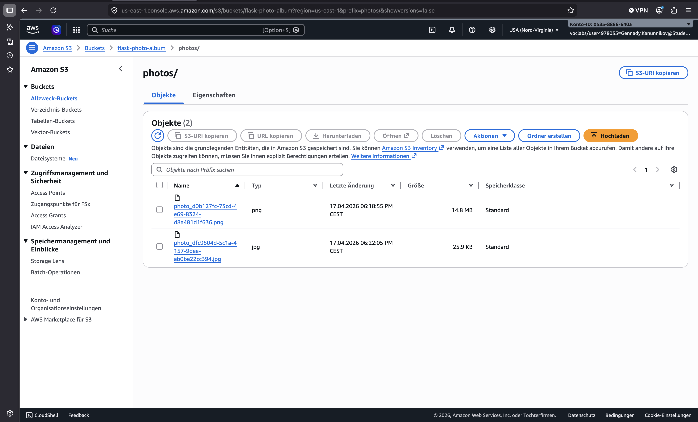
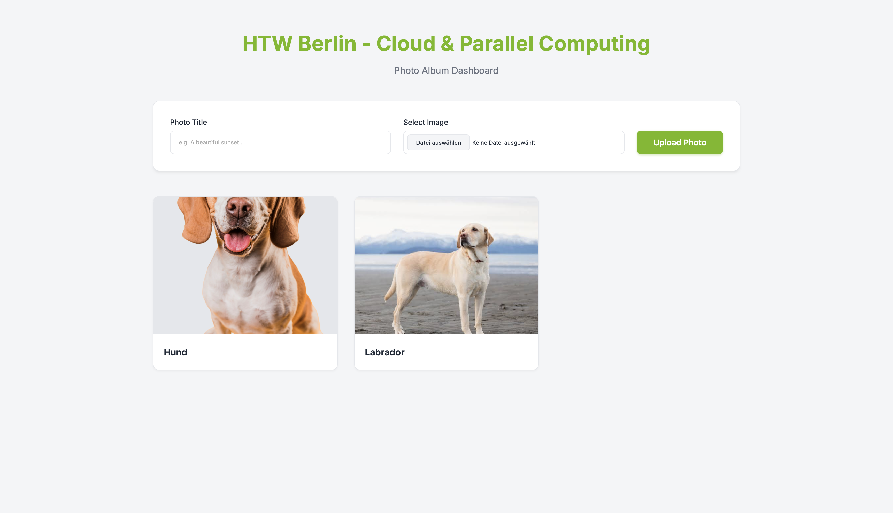
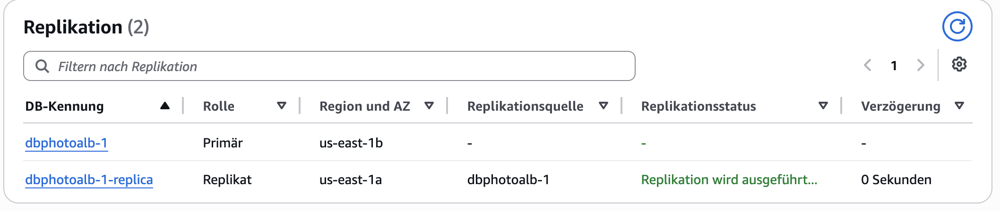
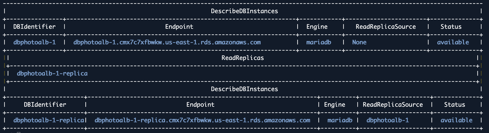
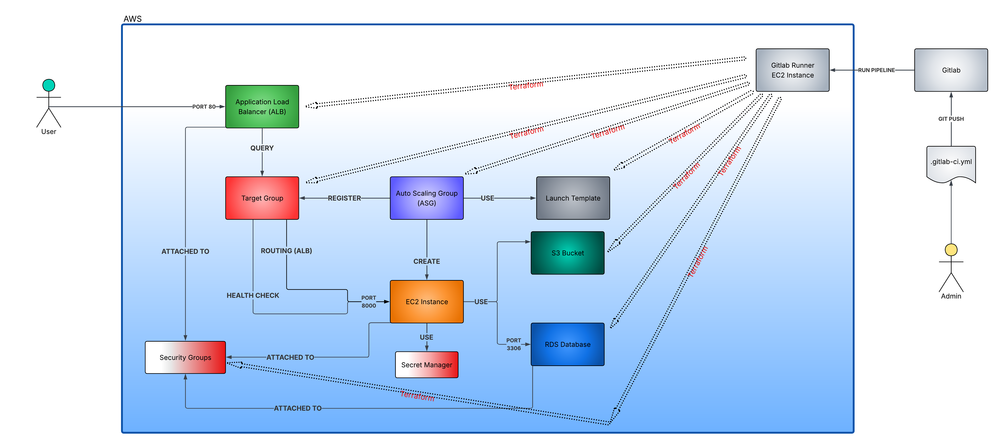
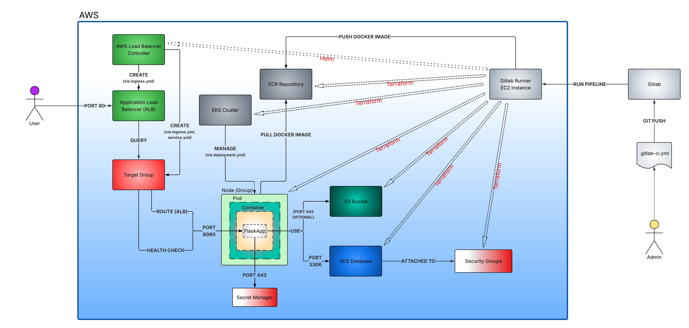
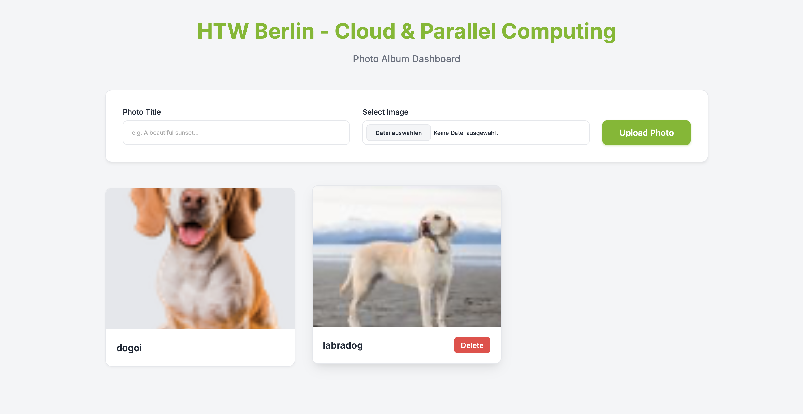
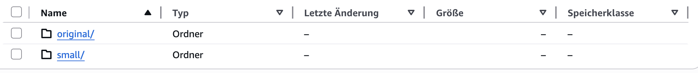
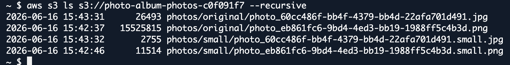
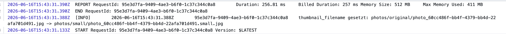

# Abgabe 1.
## S3-Bucket

# Abgabe 2.
## FlaskWeb

# Abgabe 3.
## RDS-DATABASE

# Abgabe 4.
## AWS ARCHITECTURE 

*Ein Architektur-Diagramm, welches die von Terraform kreierten AWS-Komponenten/Instanzen in Beziehung zueinander darstellt.*

# Abgabe 5.
## AWS Architecture Kubernetes

*Ein Architektur-Diagramm, welches die von Terraform und kubeclt/helm kreierten AWS-Komponenten/Instanzen in Beziehung zueinander darstellt.*

# Abgabe 6.
## S3 Bucket thumbnails on the Flaskwebapp

*Hier ist die Flaskwebapp mit den Thumbnails zusehen. Jedoch bevor das Thumbnail nach dem Upload erscheint, dauert das ein wenig. Deswegen sollte man ein paar Sekunden warten (ca. 10s-30s) und nochmal die Webseite neuladen, danach sollten die Thumbnails zu sehen sein.*

### S3 Bucket folders

*Das ist der S3 Bucket mit dem Unterordner "Original" für die Originalbilder sowie dem Unterordner "Small" für die Thumbnails.*

*Hier sind sie nochmal ausführlich mit Beispielbildern zu sehen.*

## CloudWatch Logs

*Die CloudWatch Logs zeigen wie das Originalbild ins Thumbnail, also das .small Bild umgewandelt wurde.*